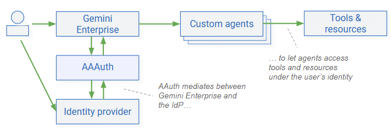
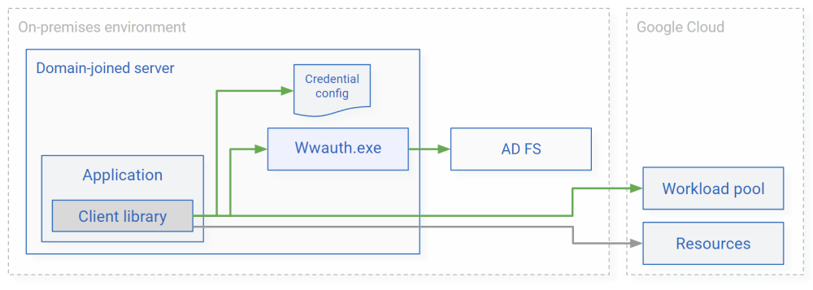
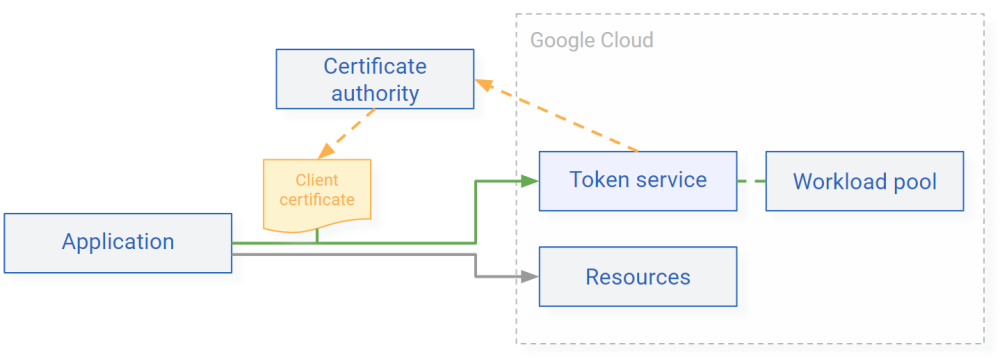

# IAM federation tools

The [`iam-federation-tools`](https://github.com/GoogleCloudPlatform/iam-federation-tools/) repository 
contains a collection of open-source tools that let you use 
federated authentication between Google Cloud and external identity providers.

## ADK Authentication Providers

A [collection of example authentication providers](adk.md) 
that let ADK agents authenticate in ways the ADK doesn't provide built-in support for.

## AI Agent Authenticator

[{ align=right width="350" }](aaauth.md)

The [AI Agent Authenticator (AAAuth)](aaauth.md) enables delegated authentication 
between [Gemini Enterprise and custom ADK or A2A agents](https://docs.cloud.google.com/gemini/enterprise/docs/agents-overview)
by acting as an intermediary between Gemini Enterprise and your identity provider.

## Workload Authenticator for Windows (archived)

[Workload Authenticator for Windows (WWAuth)](wwauth.md) was a tool that
let Windows applications authenticate to Google Cloud using their 
Active Directory Kerberos credentials. 

[{ align=right width="350" }](wwauth.md)

The tool worked by chaining two token exchanges:

1.  First, WWAuth used an application's Kerberos credentials to authenticate to
    Active Directory Federation Services and obtain a SAML assertion or OAuth access token.
2.  Second, it used the AD FS-issued SAML assertion or OAuth access token and
    exchanges it against short-lived Google credentials by using workload identity federation.
    
Using WWAuth was an alternative to using service account keys
and did't require you to manage and store any secrets or keys.

The project has been archived and is no longer being maintained.

## Token Service (archived)

[{ align=right width="350" }](token-service.md)
The [Token Service](token-service.md) was an example implementation of a token broker 
that lets IoT devices and on-premises workloads authenticate 
to Google Cloud using credentials that workload identity federation doesn't support natively.

The project has been archived and is no longer being maintained.
